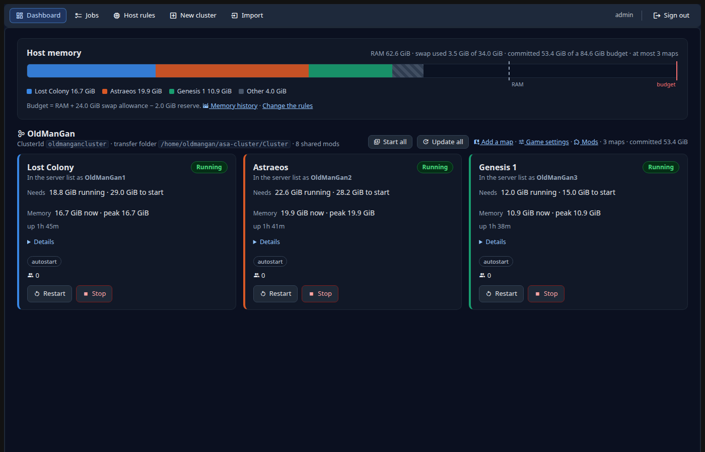
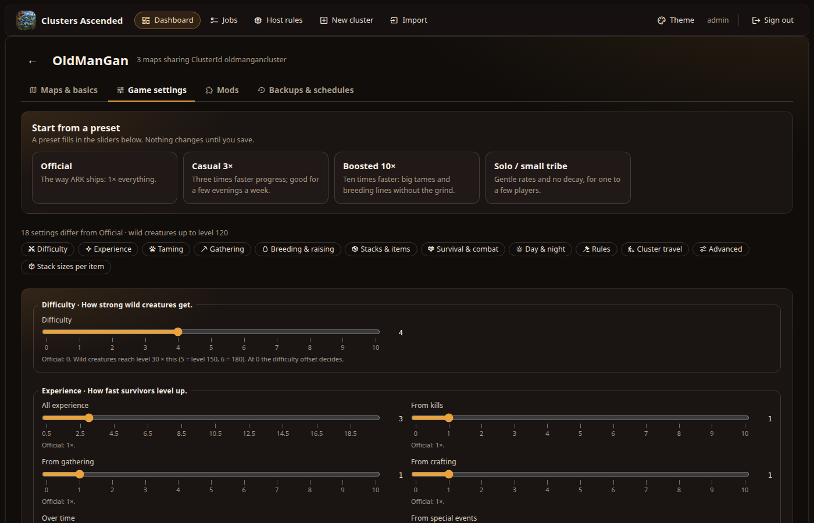
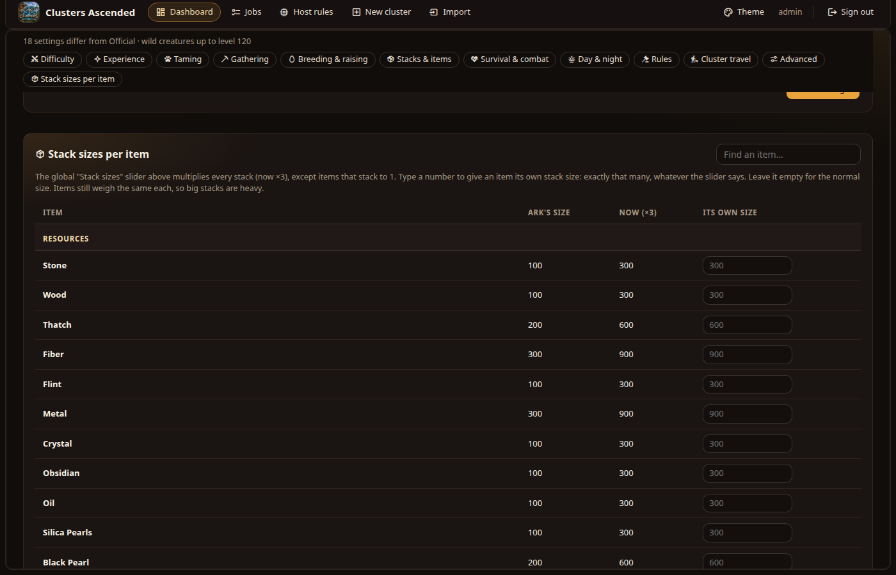
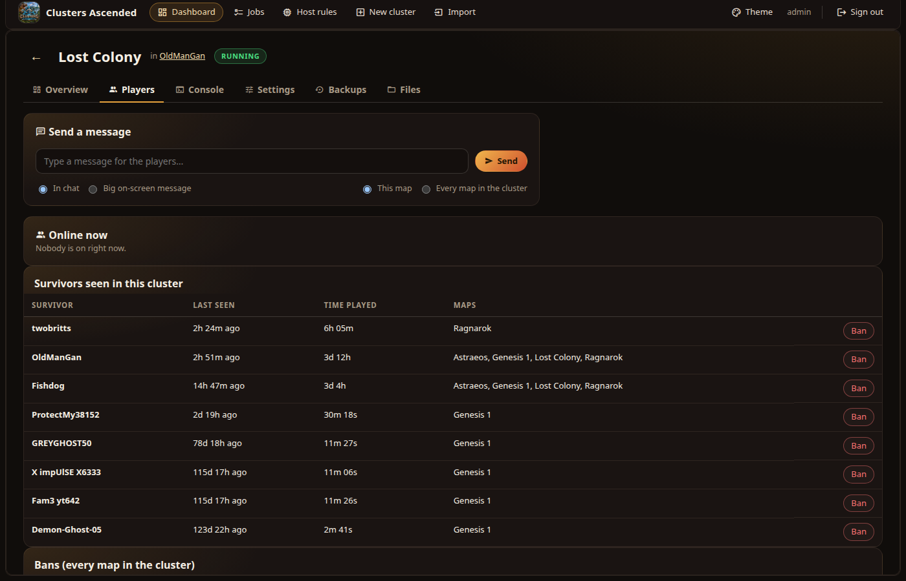
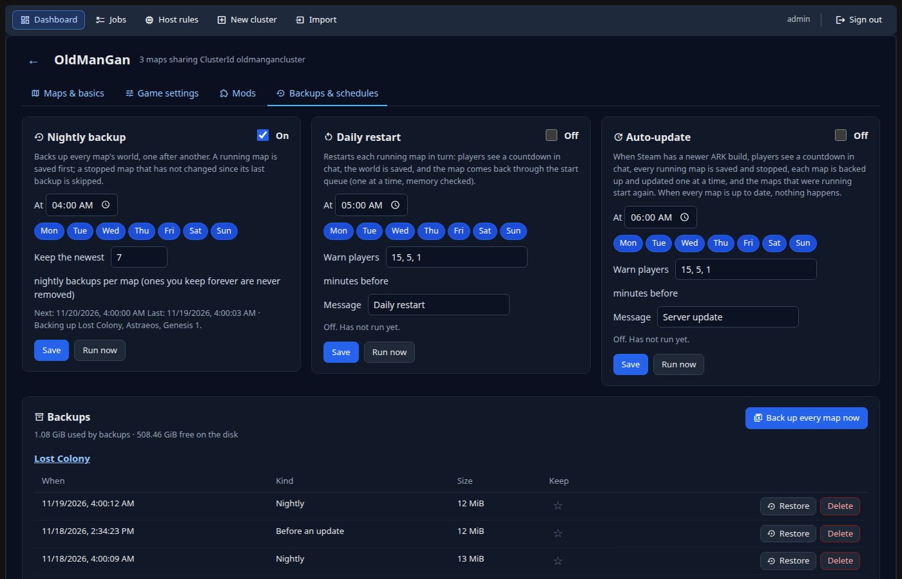

# Clusters Ascended

Run your own **ARK: Survival Ascended** cluster at home without being a
server administrator. Clusters Ascended is a web app for one machine: you
define a cluster, add maps to it, and manage everything from sliders,
switches and buttons, while the app makes sure the machine never runs out
of memory.



**Full documentation: the [project wiki](../../wiki).**

## What it does

- **Clusters first.** A cluster is a set of maps that share a ClusterId,
  so survivors, creatures and items travel between them. Its maps share
  game settings, mods and passwords; any map can differ where you want it
  to. A single map is a one-map cluster, and one machine can run several
  clusters, each with its own maps.
- **Never runs out of memory.** Every map has a *running need*, measured
  once it is fully up, and a larger *startup need*. A map only starts if
  the host can hold it. Starts run one at a time through a **start queue**:
  each map waits its turn, memory is checked again, the map starts fully
  and is measured, then the next one begins. Starts retry on a crash
  while loading, can be cancelled, and a **memory watchdog** saves and
  stops a map before the kernel would kill one. **Memory history** charts
  show every map's memory over the last 14 days.
- **Game settings as sliders.** Difficulty, experience, taming,
  gathering, breeding and raising, stacks, survival, day and night,
  rules and cluster travel, with presets (Official, Casual 3×,
  Boosted 10×, Solo). **Per-item stack sizes** for about 60 items. The
  app writes them into each map's files right before it starts, so ARK
  never overwrites them.
- **Mods** by CurseForge id, in load order, with names you give them.
- **Backups and schedules.** Nightly backups (keep the newest N; keep any
  forever), one-click restore, a daily restart with an in-game countdown,
  and **auto-update** when ARK is patched.
- **Players and console.** Who is online, kick, cluster-wide bans,
  messages in chat or on screen, join and leave history, the live game
  log and admin commands.
- **Add a map** wizard: pick a map, it copies the game files (or
  downloads them), picks free ports and joins the cluster's settings.
  Maps can be removed again, with or without their files.
- **Updates** one map at a time, with a backup first; **Update all** brings
  the maps that were running back afterwards.
- **Files** tab: browse a map's world, settings and game files from the
  browser, and edit config files while it is stopped.

| | |
|---|---|
|  |  |
|  |  |

## Requirements

- Linux with **rootless Podman** (4.9+) and cgroup v2, `zstd`, GNU `tar`.
- Enough memory for your maps: an ASA map needs about 12–20 GiB running and
  more while it loads. Swap helps (the memory budget counts part of it).
- About 15 GB of disk per map, plus backups.
- Python 3.13+ and [uv](https://docs.astral.sh/uv/).
- The [wapyt](https://github.com/WAwesome-AI/wa_pytincture_widgetset)
  widget set checked out next to this repo (`../wa_pytincture_widgetset`).
- Maps run in the POK image
  [`acekorneya/asa_server`](https://github.com/acekorneya/Ark-Survival-Ascended-Server).

## Quick start

```bash
git clone https://github.com/El-Iguana/clustersascended_wapyt.git
git clone https://github.com/WAwesome-AI/wa_pytincture_widgetset.git
cd clustersascended_wapyt
uv sync --group dev
PYTHON=<a python ≥ 3.13 with pip> ../wa_pytincture_widgetset/scripts/dev_wheel.sh appcode
echo 'CA_ADMIN_PASSWORD=choose-one' > .env
scripts/dev.sh start          # http://127.0.0.1:8098/clusters_ascended/
```

On the same machine you are signed in automatically. To reach it from the
rest of your network, run it as a service behind HTTPS (Caddy): see
[Installing and running](../../wiki/Installing-and-Running).

Then create a **New cluster** and add maps with the wizard, or **Import** an
existing podman-compose cluster (POK services sharing a ClusterId). You can
have several clusters, each with its own maps, ClusterId and folders.

## Development

```bash
uv run pytest -q                                   # ~160 tests, ~40 s
CA_PASSWORD=... uv run --with playwright python tests/smoke/<script>.py
```

The engine (memory admission, the start queue, containers, backups,
schedules) is plain Python under `appcode/engine/` and is tested against a
fake `podman` and a fake RCON server. The browser UI is Python too
(pytincture + wapyt, running in Pyodide). See
[Development](../../wiki/Development) and `CLAUDE.md`.

## License

MIT.
